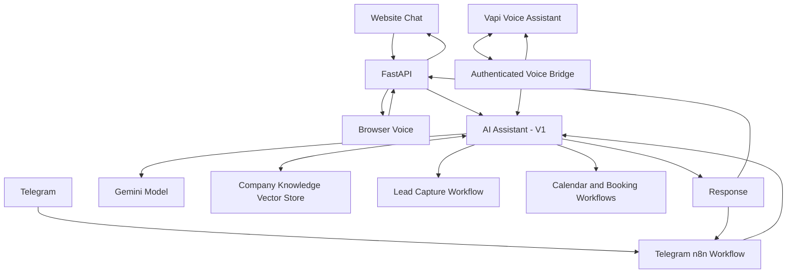

# BlueOrbit Automation Lab | AI Business Assistant

A free-first AI automation MVP demonstrating how a business assistant can serve users through a website chatbot, Telegram, and voice interfaces while reusing a central AI assistant and business workflows.

This is a learning and portfolio project. BlueOrbit Automation Lab is a fictional demonstration company, and its service descriptions and prices are sample business data.

## Features

- **Website chatbot:** React frontend connected to a FastAPI backend.
- **Company knowledge:** An n8n AI Agent uses Gemini and a vector-store retrieval tool to answer company-specific questions.
- **Telegram assistant:** A Telegram bot passes messages to the existing AI Agent and delivers responses back to the conversation.
- **Browser voice assistant:** Speech recognition converts spoken questions into text, and browser speech synthesis reads AI responses aloud.
- **Vapi voice assistant:** A voice assistant uses an authenticated n8n bridge to call the existing AI Agent.
- **Lead capture:** The AI assistant can collect lead details through the existing workflow.
- **Demo scheduling:** Existing workflows check availability and book demo appointments through Google Calendar.
- **Backend safeguards:** Request validation, input-size limits, rate limiting, concurrency limits, timeouts, and generic API errors.

## Architecture



The central `AI Assistant - V1` workflow contains the main AI Agent, model, conversation memory, company-knowledge tool, and business tools. The other interfaces pass requests to that central workflow instead of duplicating its AI logic.

### Request flow

**Website chat:** React → FastAPI `/api/ai-chat` → n8n `AI Assistant - V1` → response.

**Browser voice:** Microphone → browser speech recognition → React → FastAPI → existing AI assistant → response spoken through browser speech synthesis.

**Telegram:** Telegram Trigger → message preparation → HTTP Request → existing AI assistant → Telegram reply.

**Vapi:** Vapi voice assistant → authenticated voice bridge → existing AI assistant → response returned to Vapi.

## Technology stack

| Component | Technology |
|---|---|
| Frontend | React 19, Vite, JavaScript, CSS |
| Backend | Python, FastAPI, HTTPX |
| Orchestration | n8n |
| AI model | Google Gemini |
| Knowledge retrieval | n8n Simple Vector Store and embeddings |
| Messaging | Telegram Bot API |
| Voice | Browser Speech Recognition and Speech Synthesis; Vapi |
| Lead storage | Existing lead-capture workflow and configured database |
| Scheduling | Google Calendar integration |
| Development environment | Windows with WSL Ubuntu |

## Project status

| Capability | Verified status |
|---|---|
| Website text chat | Working |
| Browser voice chat | Working locally |
| Telegram conversation | Working |
| Company service and pricing answers | Tested |
| Conversation memory | Tested |
| Calendar availability | Tested |
| Lead capture | Tested |
| Demo booking | Tested |
| Vapi browser Talk through the n8n bridge | Tested |
| Incoming telephone call to the Vapi number | Tested |

The Vapi telephone number was provisioned and assigned to the assistant, and an incoming telephone call was tested. Browser-based Vapi Talk is also available for demonstrating the voice integration.

## Prerequisites

- Git
- Node.js and npm
- Python 3
- A local n8n instance
- Appropriate Gemini credentials and n8n workflow configuration
- Optional: a Telegram bot and its privately stored n8n credential
- Optional: Vapi account and available usage credits for the Vapi voice demo

The project was developed with n8n 2.42.4 in a local WSL environment.

**Important:** This repository includes sanitized n8n workflow templates in [`n8n/workflows/`](n8n/workflows/), with import and configuration instructions in [`n8n/README.md`](n8n/README.md). The templates omit credential bindings, pinned execution data, webhook IDs, private calendar identifiers, and instance-specific sub-workflow references. To recreate the assistant, import the dependencies first, reconnect your own credentials, configure your own calendar and Supabase tables, and set up knowledge ingestion. These are sanitized templates, not backups of a live n8n instance.

## Run locally

### 1. Configure n8n

Start n8n and configure the main workflow:

- Workflow: `AI Assistant - V1`
- Production webhook: `POST /webhook/ai-chat`
- Authentication: Header Auth
- Expected response: JSON containing an `output` field

The backend's `N8N_WEBHOOK_SECRET` must match the secret configured for the main assistant's webhook authentication. Store it only in local environment configuration and n8n credentials.

Configure the AI Agent's Gemini model, conversation memory, company knowledge tool, and any business sub-workflows you intend to demonstrate.

The current company-knowledge Simple Vector Store is in memory. Its contents are lost when n8n restarts, so rerun the knowledge-ingestion workflow after a restart when needed.

### 2. Configure the backend

From the repository root:

```bash
cd backend
python3 -m venv .venv
source .venv/bin/activate
pip install -r requirements.txt
cp .env.example .env
```

Edit `backend/.env` locally with the correct values:

```dotenv
N8N_WEBHOOK_URL=http://127.0.0.1:5678/webhook/ai-chat
N8N_WEBHOOK_SECRET=replace-with-your-local-n8n-header-auth-secret
FRONTEND_ORIGIN=http://localhost:5173
```

Replace the placeholder with the actual secret configured in your own n8n credential. Never commit the populated `.env` file.

Start FastAPI from the `backend` directory:

```bash
uvicorn main:app --reload --host 0.0.0.0 --port 8000
```

Check the health endpoint:

```bash
curl http://localhost:8000/health
```

Expected result:

```json
{"status":"ok"}
```

### 3. Start the frontend

Open another terminal at the repository root:

```bash
npm install
npm run dev -- --host 0.0.0.0
```

Open [http://localhost:5173](http://localhost:5173).

The frontend currently calls `http://localhost:8000/api/ai-chat`. Keep the FastAPI and n8n services running during local tests.

### 4. Verify the frontend

From the repository root:

```bash
npm run lint
npm run build
```

Both checks passed after the current voice-interface implementation.

## Voice assistant notes

### Browser voice

The browser voice assistant uses built-in speech APIs without requiring another npm package or a separate paid voice API.

- Microphone access requires browser permission.
- Speech recognition support varies by browser.
- Some browser implementations process recognition through an online service.
- Speech synthesis uses voices available through the browser and operating system.

### Vapi voice integration

The Vapi assistant uses an API Request tool and a dedicated authenticated n8n bridge. The bridge forwards the caller's message to the existing `AI Assistant - V1` webhook.

The current development setup uses an HTTPS tunnel to expose the bridge webhook. The ngrok traffic policy permits only the required POST webhook paths; other paths remain denied.

The tunnel, local workflows, and provider credentials are development configuration, not a production deployment. Do not publish secrets, credential exports, or private webhook authentication values in this repository.

Vapi account credits are limited, and provider pricing and free-tier terms can change. A provisioned phone number does not guarantee free outbound or international calling.

## Security and limitations

- Keep API keys, bot tokens, webhook secrets, and provider credentials out of source control.
- Keep populated `.env` files local.
- Never commit raw n8n exports containing credentials or sensitive execution data. Only publish workflow templates after sanitizing and reviewing them.
- Use separate credentials for separate integrations.
- Do not expose the n8n editor through a public tunnel.
- The backend rate limiter is in memory and is intended for a local MVP, not as a distributed production rate limiter.
- The Simple Vector Store is ephemeral and must be populated again after an n8n restart.
- Demo services and prices are fictional sample data, not commercial offers.

## Learning goals

This project demonstrates practical integration of frontend development, API design, workflow orchestration, AI-assisted retrieval, messaging, browser voice, tool calling, lead capture, calendar automation, request validation, and basic service safeguards.

The architecture is intentionally free-first and focused on a working end-to-end portfolio demonstration. Production hosting, persistent vector storage, telephony, monitoring, privacy requirements, and additional security controls should be evaluated against real requirements and budget before commercial use.
